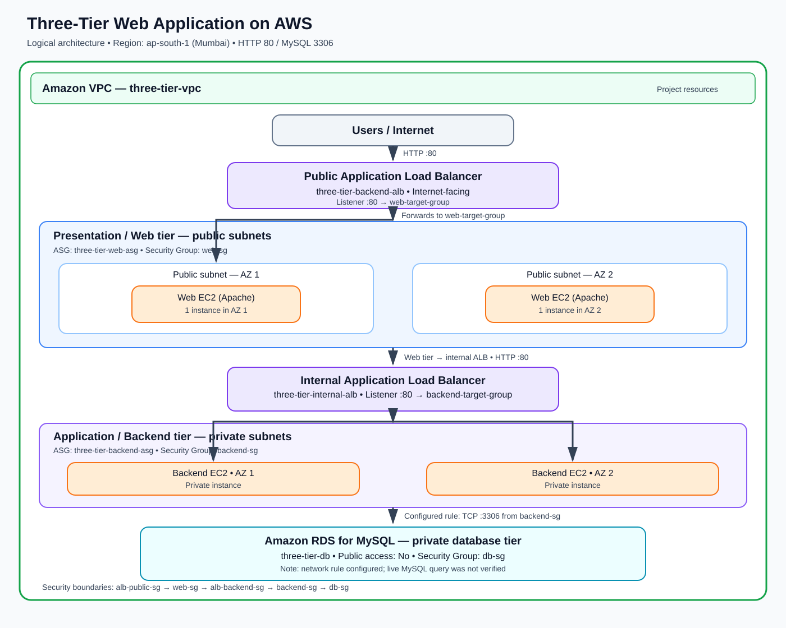

# Three-Tier Web Application on AWS

A hands-on AWS infrastructure project demonstrating a three-tier architecture with a public web entry point, a private backend tier, and a private MySQL database.

> **Project scope:** This repository documents the infrastructure that was built and tested. The web and backend EC2 instances used Apache to demonstrate the HTTP routing path; a full business-logic application and a live MySQL query test were not implemented. See [Validation and limitations](#validation-and-limitations).

## Architecture



### Request flow

1. A user sends an HTTP request to the **internet-facing Application Load Balancer**.
2. The public ALB forwards traffic to `web-target-group`.
3. The target group routes traffic to the web EC2 instances running Apache.
4. The web tier sends an HTTP request to the **internal Application Load Balancer**.
5. The internal ALB forwards traffic to `backend-target-group`.
6. The backend EC2 instances are configured to allow MySQL traffic to the private Amazon RDS database on TCP port `3306`.

## AWS services and components

| Component | Purpose |
|---|---|
| Amazon VPC | Isolated network for project resources |
| Public and private subnets | Separate internet-facing and private tiers across Availability Zones |
| Internet Gateway | Internet connectivity for the public-facing network |
| Amazon EC2 | Hosts the web and backend tier instances |
| EC2 Launch Templates | Define instance launch configuration |
| Auto Scaling Groups | Maintain desired EC2 capacity and support scaling policies |
| Application Load Balancer (public) | Entry point for HTTP traffic; forwards to the web target group |
| Application Load Balancer (internal) | Routes web-tier requests to the backend target group |
| Target Groups | Register targets and perform health checks |
| Security Groups | Restrict traffic between the tiers |
| Amazon RDS for MySQL | Managed relational database in private networking |
| Custom AMI | Reused an image with Apache installed for backend instances in private subnets without NAT |


## Security design

The intended traffic restrictions were:

- Public ALB: accept HTTP traffic from the internet.
- Web EC2 instances: accept HTTP only from the public ALB security group.
- Internal ALB: accept HTTP from the web tier security group.
- Backend EC2 instances: accept HTTP from the internal ALB security group.
- RDS: allow MySQL TCP `3306` from the backend security group, not from the public internet.

Security-group references help express tier-to-tier access without opening application and database ports broadly.

## Challenges and solutions

### 1. Package installation failed in private subnets
**Cause:** Backend instances had no public IP and the VPC did not have a NAT Gateway, so instances could not reach public package repositories at launch.

**Resolution:** Created a custom AMI from a working instance with Apache installed and used it in the backend launch template, avoiding the need to download Apache during backend instance startup.

**Trade-off:** The backend AMI was cloned from the web instance and therefore served the same sample page. It demonstrated the network path, but it was not a separate business-logic application.

### 2. Backend targets did not appear as expected
**Cause:** The backend Auto Scaling Group was not initially associated with `backend-target-group`.

**Resolution:** Attached the target group to the backend ASG, updated the launch template, and replaced old instances. The backend target group subsequently showed two healthy targets.

### 3. Web instances did not serve the expected page
**Cause:** Older instances did not have the desired Apache setup.

**Resolution:** Added Apache installation and service startup commands to the web launch template's User Data and replaced old instances. Verified Apache was active and `curl http://localhost` returned the expected page.

### 4. Load-balancer traffic path needed correction
**Resolution:** Confirmed the public ALB forwarded to `web-target-group`, and the web tier called the internal ALB, which forwarded to `backend-target-group`.

### 5. Private backend access
Backend instances had no public IP. To avoid introducing extra services and cost solely for testing, the RDS security-group rule was checked rather than opening backend instances to the internet.

## Validation and limitations

**Verified during the build**
- Apache was active on a replacement web instance.
- `curl http://localhost` returned `Three-Tier Web Presentation Layer`.
- The web target group showed two healthy targets.
- The backend target group showed two healthy targets.
- A `curl` request from the web tier to the internal ALB returned an HTTP response.
- The RDS security group was configured to allow TCP `3306` from the backend security group.


## Key learnings

- Design network boundaries before launching resources.
- A private subnet needs an intentional egress path for package downloads; NAT is one option, not a default requirement.
- An Auto Scaling Group must be associated with the intended target group.
- A healthy target group verifies only that target group's configured health check; it does not prove the whole application works end-to-end.
- Launch templates and AMIs make instance configuration repeatable.
- Delete cloud resources in dependency order and verify storage, snapshots, load balancers, and databases to avoid unexpected costs.

## Cleanup

The project's Auto Scaling Groups, EC2 instances, load balancers, target groups, launch templates, custom AMI/snapshot, project security groups, project VPC, Internet Gateway, EBS volumes, and RDS database were deleted after testing.

## Suggested resume bullet

**Three-Tier Web Application on AWS** — Built a segmented AWS architecture using VPC subnets, EC2 Auto Scaling Groups, public and internal Application Load Balancers, Security Groups, and private Amazon RDS for MySQL; troubleshot private-subnet package installation and target-group registration, and validated web-tier and internal-ALB HTTP connectivity.

## Repository contents

```text
three-tier-aws-app/
├── README.md
├── images/
│   └── architecture.svg
└── docs/
    └── troubleshooting.md
```
